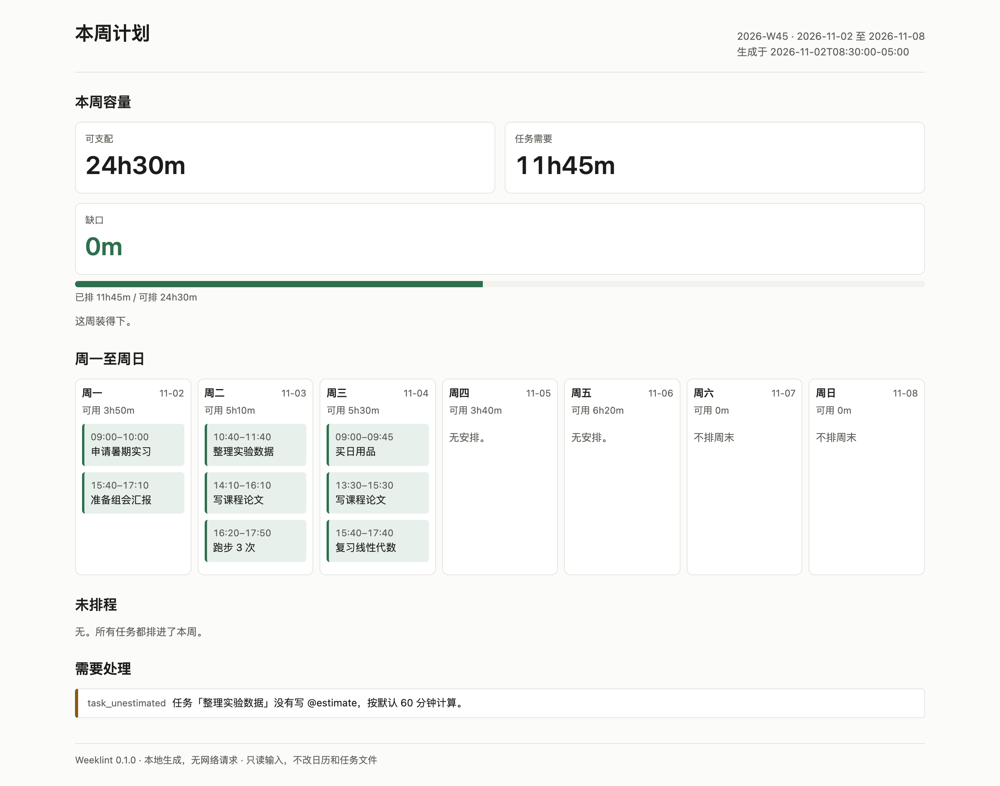

<p align="center"></p>

<h1 align="center">Weeklint</h1>

<p align="center"><strong>Check whether the week actually fits before you say yes.</strong></p>

<p align="center">
  <a href="README.md">中文</a> ·
  Python 3.11+ · MIT · local-first · no network · no account
</p>

Weeklint is a local-first weekly feasibility checker. It reads a Markdown task list and an ICS calendar, tells you whether the week fits, names the tasks that cannot fit, and then produces an explainable, lockable week plan for the part that does fit.

It is for people whose week is chopped up by classes, meetings, part-time work and deadlines. You do not upload your calendar, and you do not ask an LLM to guess your priorities.



> The screenshot is real output from `examples/`; the command and fixed `--now` are in "Reproduce the screenshot". No numbers were edited and no placeholder text was used.

## The problem

Most todo tools assume that anything put on a calendar will get done. In practice:

- a week has a fixed number of usable minutes, and meetings have switching costs;
- a 4-hour task does not fit into a day with only 40-minute gaps;
- saying yes to a new task can silently push a deadline over;
- last week's confirmed plan should not be shuffled just because you re-ran the scheduler.

Weeklint does the subtraction first: work hours minus calendar events minus buffer equals real free time. It compares that with task estimates. If demand exceeds usable time, it does not pretend the week fits: it reports the gap in minutes and the tasks whose deadlines are at risk. Only then does `plan` schedule, and it only schedules whole tasks. It never leaves half a task on the calendar.

## Who it is for / not for

**Good fit**

- You have regular work hours and some meetings, and want a 10-second answer to "can I take this on this week?"
- You keep tasks in Markdown and meetings in Google/Outlook/Apple Calendar, but do not want another SaaS to sync both.
- You want a deterministic, explainable schedule: why is this task on Tuesday afternoon rather than Monday morning?

**Not a fit**

- Team scheduling with approvals, shared calendars or cloud sync.
- AI task decomposition, automatic prioritisation or chat.
- CalDAV/Google Calendar write-back; Weeklint reads an exported ICS file.

## Core flow

```text
calendar.ics ──┐
               ├─► check ──► capacity / demand / gap / findings
tasks.md ──────┘                │
                                ├─► plan ──► plan.json / plan.ics / plan.md / report.html
                                │              (locks blocks from the previous plan)
                                └─► today ──► what to do today, what is next
```

- `check` only computes and writes nothing. Use it before accepting a new task.
- `plan` schedules and writes four files. Use it on Sunday evening or Monday morning.
- `today` reads the current plan and shows only today. Use it every morning.

## Features

Full behavior, limits and error codes are in [docs/features.md](docs/features.md).

- **Capacity ledger**: work, busy, buffer, free and usable minutes; the numbers can be recomputed.
- **Tiny task syntax**: one checkbox per line, with `@due`, `@estimate`, `@priority`, `@tag`, `@id`; unknown metadata is an error, not silently ignored.
- **Real calendars**: recurring ICS events, EXDATE, all-day events, time zones and DST; `TRANSPARENT` / `CANCELLED` events do not block time.
- **Deterministic scheduling**: overdue/deadline/priority/estimate ordering; 30–120 minute blocks; high priority prefers mornings; daily task and deep-work caps; whole-task rollback.
- **Locked previous plan**: blocks that are still valid are kept as `locked=true`, so a re-run does not shuffle a confirmed plan.
- **Explainable**: every block has a `reason`; `explain` answers "why here?" or "why not scheduled?".
- **Standalone report**: light/dark, 375 px and print styles; no scripts, external fonts, CSS or images.
- **Stable errors**: `{error, code, detail}` with exit codes 0/1/2/3; messages carry the file, line or field, without dumping the whole task file.

## Quick start

Requires Python 3.11+ and `venv`. No API key, database or server.

Weeklint is not on PyPI yet; install from source:

```bash
# from the repository root (the directory with pyproject.toml)
python -m venv .venv
source .venv/bin/activate          # Windows: .venv\Scripts\activate
python -m pip install -e .
```

Create a workspace:

```bash
mkdir ~/week && cd ~/week
weeklint init
```

This creates:

```text
weeklint.yaml   timezone, work hours, buffer, output directory
tasks.md        one checkbox per line
calendar.ics    empty calendar; export your real calendar here
```

Change at least:

1. `timezone` in `weeklint.yaml` to your IANA zone (for example `Asia/Shanghai`).
2. Replace `calendar.ics` with a real calendar export.

Add tasks:

```markdown
- [ ] Write course paper @due(2026-11-05T17:00) @estimate(240m) @priority(high) @tag(course)
- [ ] Prepare lab meeting @due(2026-11-03T14:00) @estimate(90m) @priority(high) @tag(research)
- [ ] Review linear algebra @due(2026-11-06) @estimate(120m) @priority(normal)
- [ ] Buy groceries @estimate(45m) @priority(low)
```

Check the week:

```bash
weeklint check
```

Then generate the plan:

```bash
weeklint plan
```

Open `.weeklint/report.html`. The same directory contains `plan.json` (next run locks its blocks), `plan.ics` (import into a calendar), `plan.md` (plain text) and `report.html` (standalone).

See today's plan:

```bash
weeklint today
```

## Configuration

Minimal:

```yaml
version: 1
timezone: Asia/Shanghai
```

Common fields:

```yaml
version: 1
timezone: Asia/Shanghai
planning:
  work_hours:
    mon: ["09:00-12:00", "13:30-18:00"]
    tue: ["09:00-12:00", "13:30-18:00"]
    wed: ["09:00-12:00", "13:30-18:00"]
    thu: ["09:00-12:00", "13:30-18:00"]
    fri: ["09:00-12:00", "13:30-18:00"]
    sat: []
    sun: []
  buffer_after_event_minutes: 10
  gap_between_tasks_minutes: 10
  min_block_minutes: 30
  max_block_minutes: 120
  max_deep_work_minutes_per_day: 180
  max_tasks_per_day: 4
  task_file: tasks.md
  calendar_files: [calendar.ics]
  output_dir: .weeklint
```

Full schema, defaults and validation errors are in [SPEC.md](SPEC.md) section 2. Paths are relative to `weeklint.yaml`; `~` is expanded.

## Commands

```text
weeklint [--config PATH] [--json] [--now ISO] [--week YYYY-Www] [--no-color] <command>

weeklint init [--dir PATH]
weeklint check [--week YYYY-Www]
weeklint plan [--week YYYY-Www] [--no-report]
weeklint today
weeklint explain <task-id-or-title-substring> [--week YYYY-Www]
weeklint doctor
weeklint version
```

- Global flags may appear before or after the command.
- `--json` writes exactly one JSON object to stdout; errors still go to stderr.
- `--now` overrides "now" for reproducible output; accepts ISO 8601 with offset or a plain date.
- `--week` selects an ISO week; `2026-W53` exists, `2027-W53` does not.
- Exit codes: `0` normal; `1` at least one error finding; `2` config/input/write error; `3` unexpected internal error.

## Report

`report.html` is a single file:

- follows the system light/dark preference; every color comes from a CSS token;
- 375 px single column with no horizontal scrolling;
- print-friendly, no block splitting, body text at least 11pt;
- no `<script>`, no external CSS/JS/fonts/images, no network requests;
- every task title, tag and filename is HTML-escaped.

See [DESIGN.md](DESIGN.md) for the token list and constraints.

## Privacy and security

- **No network calls**: no `requests`/`httpx`/socket client; a test replaces `socket.socket` with a function that raises.
- **No account, OAuth, LLM or telemetry**: no API key to configure.
- **Read-only inputs**: reads only `task_file` and `calendar_files`; writes only `output_dir`.
- **No calendar write-back**: `plan.ics` is an export; your source calendar is untouched.
- **Atomic writes**: temp file + `os.replace`; the old `plan.json` is copied to `plan.prev.json`.
- **Errors do not leak content**: messages carry paths, line numbers and field names, not the whole task file.

## Known limitations

- ICS `RECURRENCE-ID` overrides are skipped with a warning instead of merged; that occurrence still blocks its original time.
- RRULEs are expanded only for the selected week, capped at 1000 occurrences per event.
- One task file and at most 20 calendar files per run.
- No real Windows machine was used during development; CI covers `windows-latest`.
- Not a CalDAV client; export `.ics` manually.
- `plan.ics` uses UTC timestamps and no VTIMEZONE; the importing client converts to local time.

See [docs/deviations.md](docs/deviations.md) for every implementation deviation.

## Reproduce the screenshot

```bash
python -m weeklint plan --config examples/weeklint.yaml --now 2026-11-02T08:30:00-05:00
```

Open `examples/.weeklint/report.html`. The screenshots use Playwright at 1280 px light, 1280 px dark and 375 px, with no content editing. Sample inputs are in [examples/](examples/).

## Documentation

- [SPEC.md](SPEC.md): the behavior contract (config, CLI, JSON, error codes, test requirements).
- [DESIGN.md](DESIGN.md): report design tokens, 375 px and print rules.
- [docs/features.md](docs/features.md): implemented behavior and limits.
- [docs/development.md](docs/development.md): development, tests and release.
- [docs/deviations.md](docs/deviations.md): deviations and reasons.
- [docs/external-apis.md](docs/external-apis.md): verified external formats and library behavior.
- [docs/选题.md](docs/选题.md): topic selection, competitors and scoring.
- [CHANGELOG.md](CHANGELOG.md): release notes.
- [examples/](examples/): reproducible sample input and screenshot command.
- [docs/screenshots.md](docs/screenshots.md): real light, dark and 375 px screenshots.

## Development

```bash
python -m pytest -q
python -m pytest -q -k "planner or report"
```

Tests do not use the network, do not sleep, and do not depend on the system time zone. Time is injected with `--now`; files go to temporary directories. See [docs/development.md](docs/development.md).

## License

[MIT](LICENSE).
