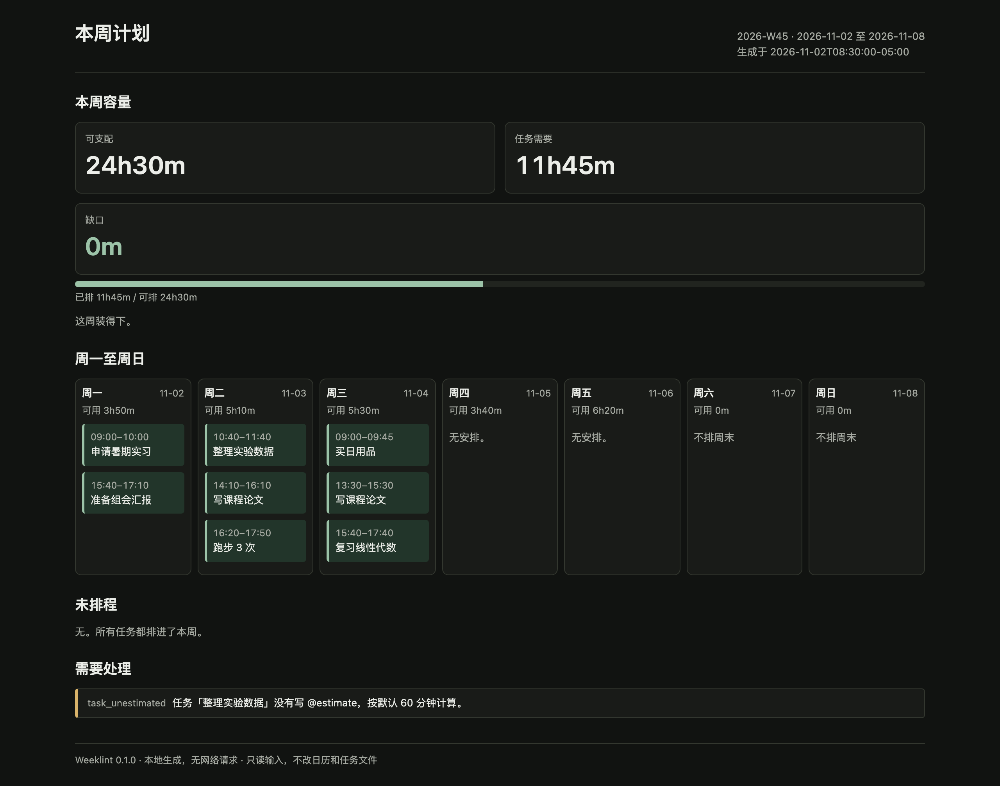
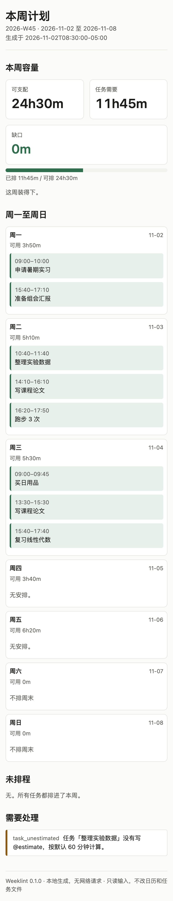

# 报告截图

三张图都来自同一个真实输出：

```bash
python -m weeklint plan --config examples/weeklint.yaml --now 2026-11-02T08:30:00-05:00
```

- 浅色 1280px：[screenshot-desktop.png](../assets/screenshot-desktop.png)
- 深色 1280px：[screenshot-dark.png](../assets/screenshot-dark.png)
- 375px 单列：[screenshot-375.png](../assets/screenshot-375.png)

生成方式：Playwright + Chromium headless shell，`deviceScaleFactor=2`，`colorScheme=light/dark`，`viewport` 1280×1000 或 375×1000，`fullPage=true`。没有编辑图片内容。

检查过的点：

- 375px 下 `scrollWidth == clientWidth == 375`，无横向滚动；
- 深色模式通过 `prefers-color-scheme: dark` 切换；
- 报告不含 `<script>`、外链、`url(...)`；
- 所有用户字符串经过 HTML 转义；
- 打印样式正文 11pt，块不跨页。





